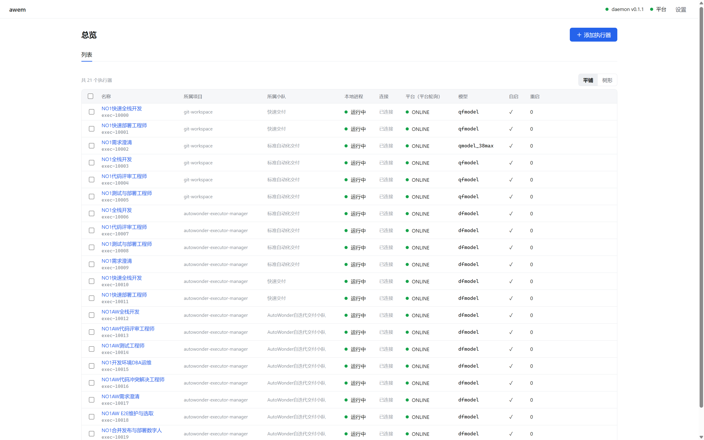
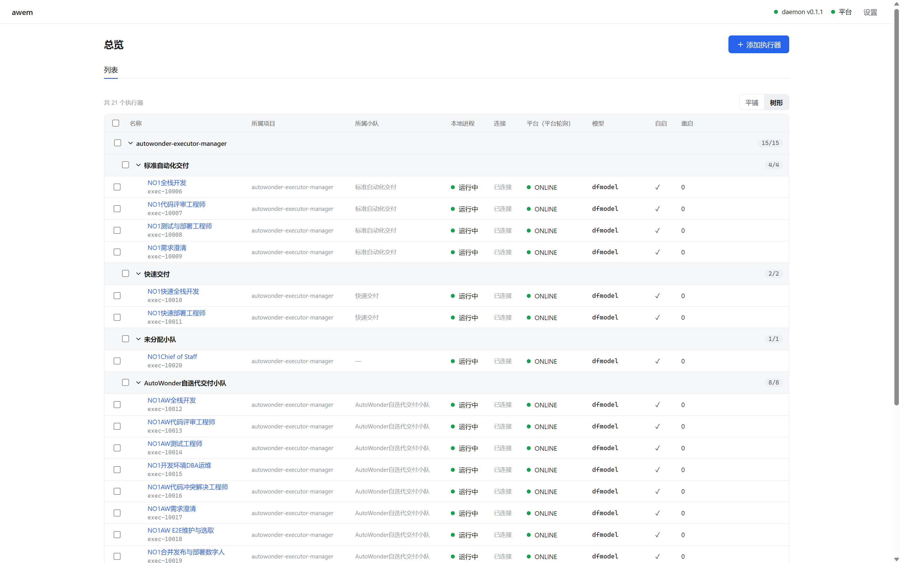
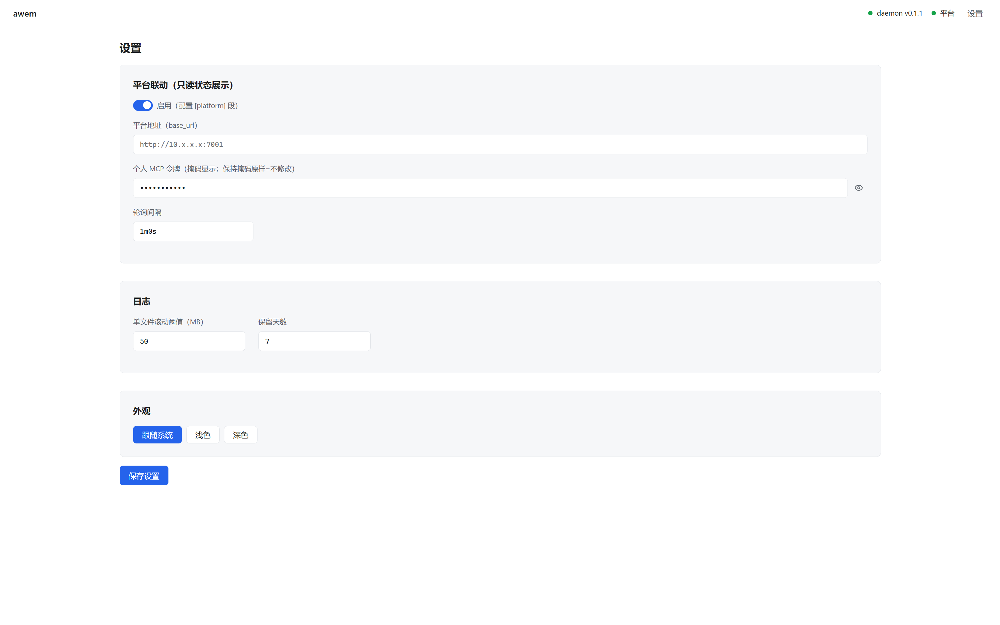

#  awem · AutoWonder Executor Manager

> 跨平台（Windows / Linux / macOS）的本机 AutoWonder 执行器管理应用。
> 单一 Go 二进制 = 常驻 daemon + 内嵌 Web 页 + CLI 子命令；AI 用 CLI 维护，人用 Web 页维护。

**状态**：v1 功能开发完成（70/71 功能点检查通过；余量见下），可用。
进度与检查记录见[开发任务索引](docs/task-awem-dev/index.md)。

## 界面预览

<table>
  <tr>
    <td width="33%" align="center" valign="top">
      <a href="docs/images/overview-list.png"></a>
      <br><sub>总览·平铺</sub>
    </td>
    <td width="33%" align="center" valign="top">
      <a href="docs/images/overview-tree.png"></a>
      <br><sub>总览·树形</sub>
    </td>
    <td width="33%" align="center" valign="top">
      <a href="docs/images/settings.png"></a>
      <br><sub>设置</sub>
    </td>
  </tr>
</table>

## 为什么需要 awem

AutoWonder 执行器本质是一个长驻进程（`npx -y autowonder@<ver> connect …`，WebSocket 连平台领任务）。此前每台机器靠一份手工 bash 脚本管理，痛点集中：

- 脚本分散、手工编辑、无统一视图；改模型 / 换内网地址要手改硬编码数组；
- bash 在 Windows 原生跑不了；无进程守护，崩溃无人拉起；日志无上限增长；
- 本地进程状态与平台 ONLINE 状态两头看，排障割裂。

awem 用**结构化配置 + 进程守护 + 统一视图**替代散落脚本。

## 功能一览（已实现）

| 能力 | 说明 |
|---|---|
| CLI | `add / list / status / start / stop / restart / edit / remove / log / import / doctor / service / reload / version`；全程 `--json` 稳定 schema、幂等、规范退出码（0/1/2/3/4/5） |
| Web 页 | 总览双状态列（本地进程 / 平台在线**并列展示**）、暗底实时日志流（ANSI 渲染 + 跟随滚动）、粘贴整条命令添加（解析预览高亮）、结构化编辑、设置 |
| 进程守护 | 崩溃自动拉起（指数退避 1s→5m，稳定 10m 重置，可关）、进程树优雅终止（SIGTERM 进程组 / taskkill /T）、两层自启（`service install` + 每执行器 `autostart`） |
| 平台联动 | 个人 MCP 令牌**只读**轮询 ONLINE/BUSY/OFFLINE + 心跳 + 配置漂移标黄（五字段对比；v1 不回写平台） |
| 日志 | 每执行器独立文件、按大小滚动（默认 50MB）、保留策略（默认 7 天）+ 管理事件日志（JSONL）；`awem log -f` 与 Web WS 实时流 |
| 迁移 | `awem import` 解析旧 `executor-manager.sh`（中文名自动改名建议、坏行跳过报告、`--with-logs` 归档旧日志） |
| 安全 | API 仅绑 `127.0.0.1`；随机 token（0600）；Host/Origin 防 CSRF；输出中令牌恒掩码 |

**非目标（红线）**：不做任务派发；不做多机聚合面板；不做平台写操作（v1 只读）；v1 不做内置 MCP server（v1.5 再加）；本地 API 仅绑 `127.0.0.1`。

**待收尾**（详见[任务索引](docs/task-awem-dev/index.md)）：macOS/Windows 系统服务的真机验证、最终 16 条决策核对表的用户复核。

## 快速开始（使用者）

### 安装

GitHub Releases 提供五平台产物（linux/amd64、linux/arm64、darwin/amd64、darwin/arm64、windows/amd64）+ sha256 校验和：

```bash
# Linux / macOS（POSIX sh）
curl -fsSL <repo>/scripts/install.sh | sh            # 最新版
curl -fsSL <repo>/scripts/install.sh | sh -s -- v0.1.0  # 指定版本 / 镜像前缀

# Windows（PowerShell）
irm <repo>/raw/main/scripts/install.ps1 | iex
```

或从源码构建：`make build`（需 Go ≥ 1.26 + Node ≥ 20，见下节）。

### 从零到执行器 ONLINE

```bash
awem doctor                # ① 环境体检：Node≥20 / npx / qoder CLI / 磁盘（任一 ❌ 退出码 1）
awem service install       # ②（推荐 7×24）daemon 注册系统服务，随系统常驻
awem add "npx -y autowonder@0.3.22 connect --ws-url ws://<内网地址>/ws/executor \
  --token <executor-token> --executor-id 10086 --provider qoder --model qfmodel \
  --reasoning-effort medium --context-window 1000000 --token-aware-enable"
awem start exec-10086      # ③ 启动（名称缺省自动取 exec-<executor-id>）
awem status exec-10086     # ④ 本地进程态 + 连接状态 + 重启次数
awem log exec-10086 -f     # ⑤ 实时日志跟随
awem edit exec-10086 --autostart   # ⑥ 随 daemon 自动拉起
```

Web 页：浏览器打开 `http://127.0.0.1:<port>/`（端口见 `<配置目录>/data/daemon.json`，
任一 CLI 命令会自动拉起 daemon），首次输入 token（`<配置目录>/data/api-token`）即可。

### AI Agent

[docs/agent-guide.md](docs/agent-guide.md)——面向 AI 的 CLI 维护指南：
按“新机器从零到执行器 ONLINE”组织，含 `--json` schema、退出码表、典型工作流与排障。

### 目录布局（OS 惯例）

```
Linux   ~/.config/awem/          macOS ~/Library/Application Support/awem/   Windows %AppData%\awem\
├── config.toml        # 人可读人可改；文件监视热加载（AWEM_CONFIG_DIR 环境变量可覆盖根目录）
└── data/
    ├── api-token      # Web/CLI 鉴权 token（0600）
    ├── daemon.json    # daemon pid/port
    └── logs/
        ├── events.log             # 管理事件日志（启停/崩溃/拉起/配置变更/服务/平台联动）
        └── executors/<name>.log   # 每执行器 stdout/stderr，滚动
```

排障入口：`awem status <名>`（三层状态）→ `awem log <名>` → 事件日志 →
`awem daemon` 前台运行看报错（daemon 拉起失败时 stderr 也在 `data/logs/daemon.stderr`）。

## 文档导航

| 文档 | 内容 |
|---|---|
| [docs/agent-guide.md](docs/agent-guide.md) | AI Agent 的 CLI 维护指南（--json schema / 退出码 / 工作流） |
| [docs/dev-guide.md](docs/dev-guide.md) | 开发指南：架构图 / 代码地图 / "改哪里"路由表 / 隐性契约 / 排障与常见坑 |
| [docs/design/design.md](docs/design/design.md) | 设计基准：架构、数据模型、CLI/API/Web、安全、跨平台、里程碑 |
| [docs/design/ui-guidelines.md](docs/design/ui-guidelines.md) | Web UI 设计令牌（`--awem-*`）、状态色语义、组件规范 |
| [docs/task-awem-dev/index.md](docs/task-awem-dev/index.md) | 开发任务索引与实时进度 |
| [AGENTS.md](AGENTS.md) | 给 AI Agent 的仓库工作约定 |

## 目录结构

```
cmd/awem/        # 唯一入口（CLI/daemon/Web 同体）
internal/        # config / launchcmd / logs / supervisor / platform /
                 # api（REST+WS+鉴权）/ daemon（生命周期+惰性拉起）/ cli / service / exitcode / version
web/             # React SPA（Vite+TS；构建产物 web/dist go:embed 内嵌）
scripts/         # smoke.sh（全链路冒烟）/ install.sh / install.ps1 / verify-ui.mjs
.github/         # release.yml（tag 触发自动发布）
docs/            # agent-guide / design / task-awem-dev
```

## 开发者快速开始

环境要求：Go ≥ 1.26、make、Node.js ≥ 20。

```bash
make build                 # 前端构建 + 单二进制 ./awem（自动注入版本号）
make build VERSION=v0.1.0  # 指定版本号构建（awem version 可见）
make test                  # go test 全量（单元 + 假长驻子进程冒烟，不依赖真实平台/npx）
make vet                   # go vet 静态检查
make release               # 五平台交叉编译 + checksums.txt → release/
scripts/smoke.sh           # 三绿 + 交叉编译 + 前端构建 + UI 自检 +（Linux）服务全链路
scripts/smoke.sh --skip-service  # 无 systemd 的环境只跑构建与测试层
```

说明：

- 提交前三绿：`go build ./... && go vet ./... && go test ./...`。
- `web/dist/` 约定**构建时生成、仓库忽略**：`make build` 会在缺失时从 `web/placeholder/`
  复制占位页，保证 fresh clone 可直接构建；`go:embed` 不读取 .gitignore，本地存在即可嵌入。

工程约定：注释与文档中文、标识符英文；**实现与设计冲突时，先改设计文档、征得同意、再改代码**；测试不依赖真实平台与 npx（假长驻子进程）。详见 [AGENTS.md](AGENTS.md)。

## 平台支持与 7×24 长跑建议

- **Linux**：完整支持（systemd user 服务，`awem service install`；不登录常驻
  需 `loginctl enable-linger <用户>`，install 输出会提示）。
- **macOS**：launchd LaunchAgent（RunAtLoad + KeepAlive）；实现已就绪，
  真机安装/卸载验证待 macOS 环境。
- **Windows**：默认登录自启（HKCU Run，无需管理员）；备选 `sc create`
  系统服务（需管理员，注意 session 0 限制：Node/qoder 环境变量须机器级）。
  实现已就绪，真机验证待 Windows 环境。
- **7×24 长跑场景推荐 Linux/macOS 或 WSL**（与平台最佳实践一致）：
  进程树终止、UTF-8 管道、npx.cmd 解析均已做平台适配（`GOOS=windows`
  交叉编译保证），但 Windows 原生路径未经真机回归。

## 发布

打 tag 推送即自动发布（`.github/workflows/release.yml`）：

```bash
git tag v0.1.0 && git push origin v0.1.0
# CI：前端构建 → go vet/test + UI 自检（质量门）→ make release 五平台 +
# checksums → 产物自检（sha256sum -c + 本机产物可执行）→ 创建 GitHub Release
```

- 版本含 `-`（如 `v0.1.0-rc1`）自动标记 prerelease；
- `workflow_dispatch` 手动触发为草稿演练（用输入的版本号，不真正发版）；
- 本地等价命令：`make release VERSION=v0.1.0`（产物与校验和在 `release/`）。

## 关联

- [LinuxDo](https://linux.do/)
- LinuxDo 开源推广帖：[awem 推广主题](https://linux.do/t/topic/3077858)

- 上游开源镜像与运行时文档：[aliyun/alibabacloud-landing-zone · ai-sdlc/auto-wonder](https://github.com/aliyun/alibabacloud-landing-zone/tree/master/ai-sdlc/auto-wonder)
